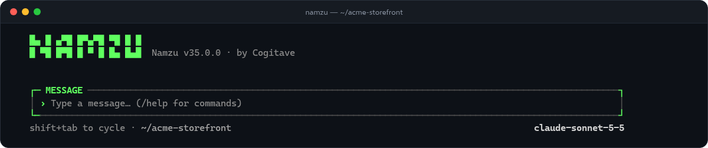

<!-- okf
type: Index
title: Namzu
description: >-
  A terminal AI agent you can use on real projects, and the open TypeScript
  SDK it is built on. It asks before it acts, keeps its records on your
  machine, and can run jobs while you are away. The SDK and most packages are
  FSL-1.1-MIT, converting to MIT two years after each release; the terminal app
  and the files package are MIT.
tags: [readme, index, typescript, agent-kernel]
status: stable
generated: { by: human:bahadirarda, at: 2026-10-13T00:00:00Z }
-->

<div align="center">

<h1>Namzu</h1>

**An AI agent for your terminal that asks before it acts, keeps its records on your machine, and can run jobs while you are away.**

[](./LICENSE.md)
[](https://www.npmjs.com/package/@namzu/cli)
[](https://www.npmjs.com/package/@namzu/sdk)
[](https://github.com/cogitave/namzu/actions/workflows/ci.yml)

[Install](#install) · [Terminal app](#the-terminal-app) · [Namzu Desktop](#namzu-desktop) · [For developers](#for-developers) · [Docs](#docs) · [Status](#status)

</div>

---

## Install

On macOS, Linux or WSL:

```sh
curl -fsSL https://raw.githubusercontent.com/cogitave/namzu/main/install.sh | sh
```

On Windows, in PowerShell:

```powershell
irm https://raw.githubusercontent.com/cogitave/namzu/main/install.ps1 | iex
```

Then run `namzu doctor` to check your sign-in and sandboxing, and `namzu` to
open the terminal app. You need Node.js 22.13 or newer, and `curl` for the
first command (on a minimal Debian or Ubuntu, `wget -qO- <url> | sh` does the
same, with the same URL). Every shell, and what to do when an install fails, is
covered in [installing Namzu](docs/cli/installation.md).

## The terminal app

Namzu in your terminal is a coding agent for the project you are working in.
It reads your code, runs commands and edits files, and it does this in the open.



- **It asks before it reaches outside your folder.** Commands and file tools run
  on your machine under a permission system. A path outside the working folder
  becomes an approval request you can answer. [Where tools run](docs/cli/tool-boundary.md)
- **You can undo a turn.** Before a tool changes a file, the app records that
  file for the turn, so `/restore` puts the tree back as it was. [File checkpoints](docs/cli/file-checkpoints.md)
- **Work can happen in a separate checkout.** Managed Git worktrees give a task
  its own copy of the project, and you can reopen that project later. [Worktrees](docs/cli/worktrees.md)
- **It drives a browser for you and hands over when a page needs you.** Site
  rules apply, and the app pauses when a page asks for a person. [The browser](docs/cli/browser.md)
- **It remembers what you ask it to keep.** Notes you curate are read into every
  conversation, and stored memories are recalled when they are relevant. [Memory](docs/cli/memory.md)
- **It follows your conventions.** Skills are loaded when the work needs them,
  and the project's `AGENTS.md` is read as instructions. [Skills](docs/cli/skills.md)
- **It connects to the tool servers you declare.** External tool servers, by
  command or URL, are authorized per project. [Tool servers](docs/cli/mcp-servers.md)
- **It keeps working when you are away.** Scheduled tasks run later while Namzu
  is closed, with approvals, missed-run handling and a history. [Scheduled tasks](docs/cli/scheduled-tasks.md)
- **It runs in scripts too.** `namzu exec` runs one prompt without a screen,
  `namzu exec --json` streams events to another program, and `namzu history`
  prints a conversation's messages as JSON. [Exec JSON](docs/cli/exec-json.md)

### Choose a model

- **Reuse a sign-in you already have.** Existing provider sessions on your
  machine are found, so you do not paste a key. [Credentials](docs/cli/credentials.md)
- **Sign in from inside Namzu.** Start a sign-in from the model picker, or run
  `namzu login`. [Credentials](docs/cli/credentials.md)
- **Use an API key.** Set the provider's key in your environment, for example
  `OPENROUTER_API_KEY`.
- **Run local models with no key.** Local models are reached through
  `@namzu/ollama`. [Model catalogue](docs/cli/model-catalogue.md)

## Namzu Desktop

**Coming soon.** Namzu Desktop is a desktop app for Windows that puts your
conversations, projects, Pals (named agents, see below), terminal tabs and
approvals in windows of their own. It is in preview and is not published yet, so there is no installer to
download. When it ships, it runs on the same runtime as the terminal app.

- Conversations open in panes and windows, with terminal tabs beside them.
- Switch between the desktop app and the terminal app from one place.
- Folder trust, approvals, model choice and background work are handled in the same app.

Details of the preview are in [the desktop guide](docs/cli/desktop.md).

## Pals

A Pal is a named agent that keeps its name, its purpose and its conversations
between sessions. You can create one from the terminal app or from Namzu Desktop:

```sh
namzu pal create Research --purpose "Reads papers and writes short summaries"
namzu pal list
```

A Pal can also have its own Linux desktop, a persistent guest computer with a
browser and a files app. Namzu never silently installs the container engine or pulls
its image; you turn the computer on explicitly. You can pause a Pal at
any time, and an operator can take over its computer, which is checked before
each action. See [Pals in the terminal app](docs/cli/pals.md),
[Pal computers](docs/cli/computer.md) and [local Pal computers](docs/sdk/local-pal-computer.md).

## For developers

`@namzu/sdk` is the TypeScript kernel the terminal app is built on. It runs an
agent the way an operating system runs a process: it gives the agent an
identity and a budget, schedules its tool calls, and checkpoints its turns. The
kernel renders no UI and requires no database. You install only the drivers you use.

### Build an agent with the SDK

Install the kernel. Pin `zod` to v3, because the kernel is built against it and
a bare `pnpm add zod` installs v4:

```bash
pnpm add @namzu/sdk zod@^3
```

Save this as `agent.ts` and run it with `pnpm exec tsx agent.ts`. It needs no key
and no network, because the mock provider plays a scripted answer:

```ts
import { ProviderRegistry, runAgent } from '@namzu/sdk'

const { provider } = ProviderRegistry.create({ type: 'mock', responseText: 'Paris.' })
const { output, turn, identity } = await runAgent({
  provider,
  model: 'mock-model',
  prompt: 'What is the capital of France?',
})

console.log(output)
console.log(turn.stopReason)
console.log(identity)
```

The turn ran through the normal lifecycle: budgets, the tool scheduler and the
session log. To continue the same session, spread `identity` into the next
`runAgent` call and pass the earlier `turn.messages`; identity alone does not
load history. To give the agent tools, and to swap in a real provider, see the
[SDK quick start](docs/sdk/quick-start.md) and the
[tool example in the SDK README](packages/sdk/README.md#give-the-agent-a-tool).

### What the kernel does for you

- **Stops runaway work.** Token, cost, time and iteration budgets are enforced
  on every turn, with a warning before the hard stop. [Token budgets](docs/sdk/token-budgets.md)
- **Survives a restart.** Each session is written to one append-only,
  hash-chained log, so a crash loses at most the line being written, and a
  paused turn can be picked up later. [Session log](docs/sdk/session-log.md)
- **Attributes every action.** Tenant, project, topic and session identities
  travel with the work, so you can tell who did what. [Identifiers](docs/sdk/ids.md)
- **Shrinks long conversations without breaking them.** Compaction never cuts a
  tool call away from its result, which would be a hard error at the provider.
  [Compaction](packages/sdk/src/compaction/dangling.ts)
- **Refuses rather than pretends.** If a turn needs an isolation control the host
  cannot supply, it does not start unconfined. [Sandboxes](docs/sdk/kubernetes-sandbox.md)
- **Makes tools declare what they are.** Each tool states whether it is read-only,
  destructive, safe to run concurrently and which permissions it needs, so the
  scheduler and the permission gate can decide. [Tool execution](docs/sdk/tool-execution.md)
- **Delegates within a budget.** A child agent gets a slice of the parent's
  remaining tokens, and the unused part comes back when it finishes. [Token budgets](docs/sdk/token-budgets.md)
- **Turns a folder into an agent.** A folder with `instructions.md`, `tools/`
  and `skills/` loads into the same options `runAgent` takes. A load can list
  the folder without running any of its code. [Directory loader](packages/sdk/src/directory/load.ts)

```text
agent/
├── instructions.md     the system prompt
├── agent.ts            optional settings: model, budgets, name
├── tools/              one file per tool
└── skills/             one folder per skill
```

### Packages

| Package | What it is for |
|---|---|
| `@namzu/sdk` | The kernel: turns, sessions, tools, budgets, compaction, checkpoints and the permission gate. [Guide](docs/sdk/index.md) |
| `@namzu/cli` | The terminal app, which is also scriptable. [Guide](docs/cli/index.md) |
| `@namzu/browser` | A browser host for agents, with site rules and a human handoff. [Guide](docs/sdk/browser-host.md) |
| `@namzu/sandbox` | Isolation providers beyond the kernel's own, including container-cluster and microVM sandboxes. [Guide](docs/sdk/kubernetes-sandbox.md) |
| `@namzu/computer-use` | Screenshots, mouse and keyboard control through platform-native tools. |
| `@namzu/ag-ui` | An AG-UI adapter for streamed text, tools and interrupts in a host interface. [Guide](docs/sdk/ag-ui.md) |
| `@namzu/live` | Live sessions that run the speech and audio drivers you supply. |
| `@namzu/lsp` | Code navigation and symbol lookup through language servers. Pre-1.0. |
| `@namzu/telemetry` | Telemetry exporters, kept apart so that a host that emits nothing installs nothing. |
| `@namzu/files` | A file registry with in-memory, local-disk and cloud-blob backends, plus an HTTP download router. |
| `@namzu/evals` | Behaviour suites that run against an installed kernel. |

### Model drivers

Each driver implements the same `LLMProvider` contract and registers through
`ProviderRegistry`, so switching models does not change the code around them.

| Package | Notes |
|---|---|
| `@namzu/anthropic` | Streaming, tool use and extended thinking |
| `@namzu/openai` | Chat completions, streaming and tool use |
| `@namzu/deepseek` | Chat completions, streaming, tool use and thinking mode |
| `@namzu/bedrock` | Converse API, streaming and tool use |
| `@namzu/openrouter` | Many hosted models behind one key |
| `@namzu/google` | Sign-in reuse or an API key |
| `@namzu/ollama` | Local models, no key needed |
| `@namzu/lmstudio` | Local models through a desktop model server. Not yet selectable in the terminal app. |
| `@namzu/zen` | Hosted models, with native wire routing. The free tier is experimental. |
| `@namzu/http` | A dependency-free driver for any compatible HTTP endpoint |

## Requirements

- **Terminal app:** Node.js 22.13 or newer, on macOS, Linux, WSL, or native
  Windows through PowerShell or the Command Prompt.
- **SDK:** Node.js 20 or newer, in an ESM project.
- **Namzu Desktop:** Windows, in preview. Not yet published.
- **Pal computers:** a local container engine that runs Linux containers, or the
  Windows WSL setup described in [local Pal computers](docs/sdk/local-pal-computer.md).

The project's tests run on Node.js 22 and 24.

## Status

- **Published now:** the terminal app (`@namzu/cli`), the SDK (`@namzu/sdk`), and
  the capability packages and model drivers listed above.
- **Not published yet:** Namzu Desktop. It is in preview and is coming.
- **Pre-1.0:** only `@namzu/lsp`. Its API still moves.
- **Major versions move quickly.** Any backward-incompatible change to a public
  API is released as a major version, however small it is. Pin your dependency
  and read the changelogs: [SDK](packages/sdk/CHANGELOG.md) and [terminal app](packages/cli/CHANGELOG.md).

## Docs

- [Documentation index](docs/index.md): the knowledge bundle, kept in the repository
  next to the code it describes.
- [Terminal app guide](docs/cli/index.md): installation, models, Pals, skills and
  the rest of the app.
- [SDK guide](docs/sdk/index.md) and the [quick start](docs/sdk/quick-start.md).
- [SDK package README](packages/sdk/README.md): a map of the kernel's subsystems.

## Contributing

Issues and pull requests are welcome at [cogitave/namzu](https://github.com/cogitave/namzu).
Start with the [SDK contributing guide](packages/sdk/CONTRIBUTING.md). The
[working contract for coding agents](AGENTS.md) describes the checks every change
must pass.

## Security

Report security issues privately, as described in the
[SDK security policy](packages/sdk/SECURITY.md).

## License

The SDK and most packages are [FSL-1.1-MIT](./LICENSE.md). You can use, modify
and redistribute them for any purpose except a Competing Use. Every published
version of those packages becomes MIT-licensed two years after its release.

`@namzu/cli` and `@namzu/files` are published under the MIT license.
